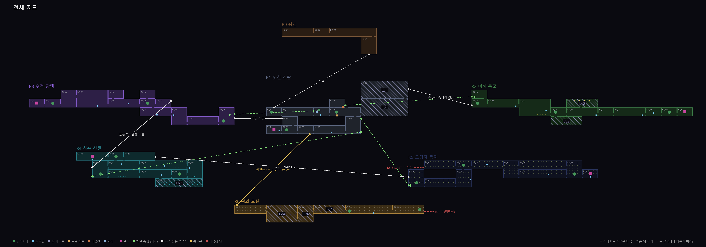
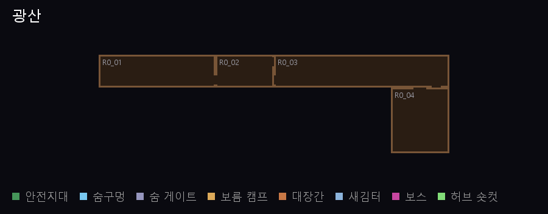
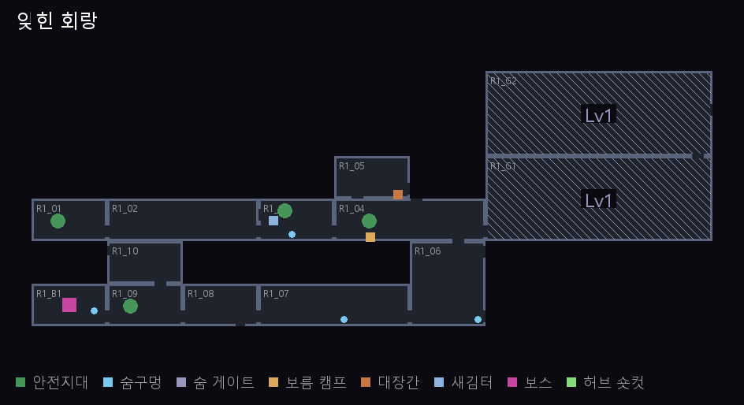
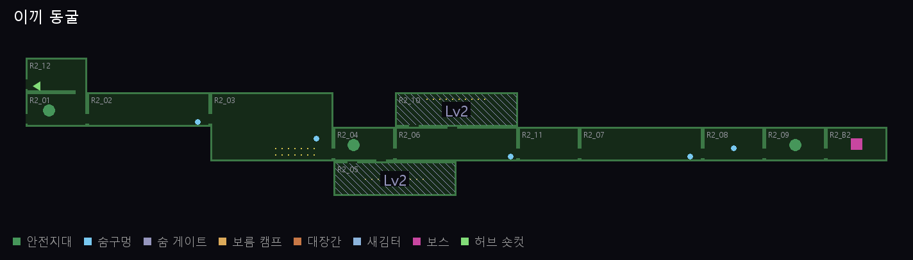
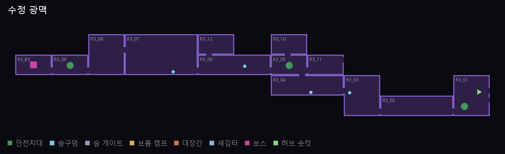
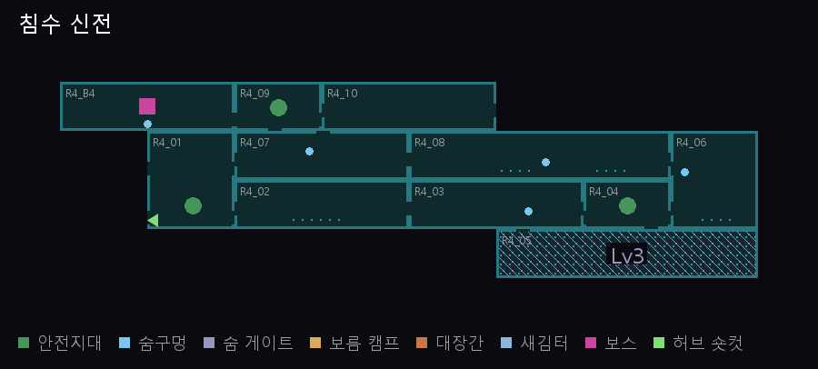
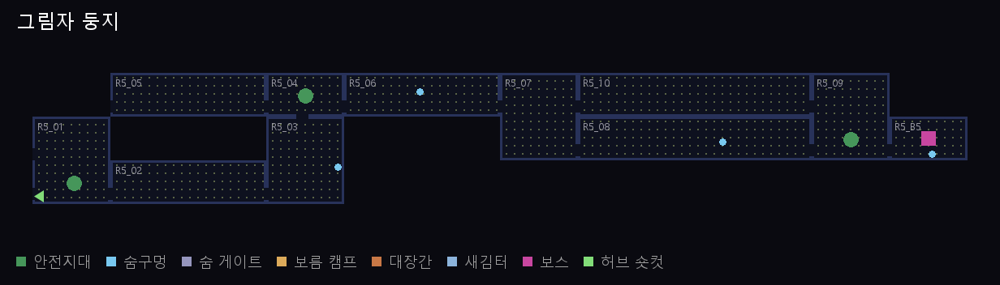
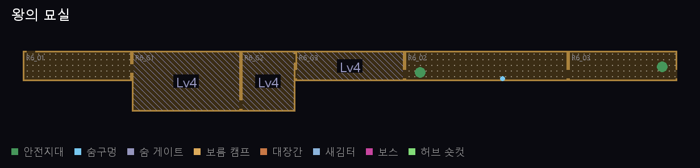

# 전체 맵 지도

> 게임에서 **Tab을 누르면 나오는 지도**(`modes/map_mode.py`)를 **모든 방 방문 · 새김터 발견 · 허브 숏컷 개방 · 보스 미처치** 상태로 다시 그린 것이다 (2026-11-18 방 데이터 기준).
> 이미지는 `map_mode.py`와 같은 규칙(방 1화면 = 96×54px, 구역 색, 출구 틈, 원·사각 아이콘, 점 무늬, 빗금)으로 렌더링했다. 방 id 글자만 문서용으로 더했다 (게임에는 없음).
> 게임 지도는 **지금 있는 구역만** 보여주므로 구역마다 한 장씩이다. 구역 사이 연결은 1장과 9장을 본다.

## 0. 보는 법

- 방 = 구역 색 테두리 사각형, 테두리가 끊긴 곳 = 출구
- 큰 초록 원 = 안전지대 · 작은 하늘색 원 = 숨구멍
- 점 무늬 = 숨 소모가 큰 곳 (포자·물·탁한 공기·희박·void) · 빗금 + `Lv?` = 숨 게이트 방
- 사각 아이콘: 주황 = 보름 캠프 · 갈색 = 대장간(하르) · 하늘 = 새김터 · 자홍 = 보스
- 초록 화살표 = 연 허브행 숏컷 (화살표가 허브 쪽을 가리킴)
- 아래 표의 기호: 🔥 안전지대 · 💨 숨구멍 · 🌫 숨 게이트 · ⚔ 보스 · 🛡 정예 · 🚪 한쪽 문(숏컷) · ★ 허브

---

## 1. 전체 지도



- 구역별 Tab 지도 7장을 한 장에 모은 것이다. 게임 데이터는 구역마다 좌표가 따로라서, **구역 배치는 개발문서 12.1 월드 지도 기준**으로 잡았다 (R1 중앙, R0 위, R3 서쪽, R2 동쪽, R4·R5 아래, R6 맨 아래).
- 구역 사이 출구를 선으로 이었다: **흰 실선** = 구역 정문 (진입 조건 표시) · **초록 점선** = R1 허브행 숏컷 · **금색** = 봉인문 · **빨간 점선** = 아직 파일이 없는 방
- 원본 크기(4000px 이상)라 확대해서 보면 방 id까지 읽힌다.

---

## 1-1. 구역 연결도 (요약)

```
                         [R0 광산]  도입부 (재방문 불가)
                          R0_04 추락
                              │
                              ▼
 ┌──────────────────────────[R1 잊힌 회랑]──────────────────────────┐
 │                                                                 │
 │  R1_10 ──────────────── R3_01 (정문)                            │
 │  R1_03 (새김터) ◀🚪──── R3_01 (허브 숏컷, 왼쪽에서 열림)        │
 │  R1_05 ◀🚪───────────── R2_12 (허브 숏컷, 오른쪽에서 열림)      │
 │  R1_04 ★ ─ R1_G1 ─ R1_G2 (숨막이 갱, 숨 Lv1) ──── R2_01 (정문)  │
 │  R1_06 ◀🚪───────────── R4_01 (허브 숏컷)                       │
 │  R1_06 ◀🚪───────────── R5_01 (허브 숏컷)                       │
 │  R1_08 (봉인문) ──▼──── R6_01                                   │
 └─────────────────────────────────────────────────────────────────┘

   [R2 이끼 동굴]        (막다른 구역: R1로만 이어짐)

   [R3 수정 광맥] R3_11 ── 높은 턱(결정의 룬) ──▶ R4_01
   [R4 침수 신전] R4_10 ── 긴 구덩이(돌파의 룬) ──▶ R5_01
   [R5 그림자 둥지]
   [R6 왕의 묘실] R6_01 ── G1 ── G2 ── G3 (void, 숨 Lv4) ── R6_02 ── R6_03 ── B6
```

**기본 진행**: R0 → R1 → (B1 / 새김터, 순서 자유) → 숨막이 갱 → R2 → B2 → R1 → R3 → B3 → R4 → B4 → R5 → B5 → R1 봉인문 → R6 → B6

---

## 2. R0 광산 (mine) — 4방



| 방 | 크기 | 출구 | 내용 |
|---|---|---|---|
| R0_01 | 2×1 | R→02 | 보름(광산), 광석 덩어리 2 |
| R0_02 | 1×1 | L→01, R→03 | 박쥐 1, 전조 연출 |
| R0_03 | 3×1 | L→02, D→04 | 붕괴 연출 |
| R0_04 | 1×2 | U→03 | 추락 → R1로 |

---

## 3. R1 잊힌 회랑 (corridor) — 13방 (허브)



| 방 | 크기 | 출구 | 내용 |
|---|---|---|---|
| R1_01 | 1×1 | R→02 | 🔥 깨어나는 방, 공기 갱 연출 |
| R1_02 | 2×1 | L→01, R→03 | 새김터 석판 A, 갱도 벌레 |
| R1_03 | 1×1 | L→02, **L2→R3_01**, R→04 | 🔥 💨 **새김터(룬지기 오람)** |
| R1_04 | 2×1 | L→03, R→G1, U→05, D→06 | ★ 🔥 **허브(보름 캠프)**, 연습 석상 |
| R1_05 | 1×1 | D→04, **R→R2_12** | 하르(NPC) |
| R1_06 | 1×2 | L→07, U→04, **R→R4_01, R2→R5_01** | 💨 광맥벽, 박쥐·벌레 |
| R1_07 | 2×1 | L→08, R→06 | 💨 희귀 광석 A, 갑각 전사 |
| R1_08 | 1×1 | L→09, R→07, **D→R6_01** | **봉인문(핵)**, 희귀 광석 B |
| R1_09 | 1×1 | L→B1, R→08, U→10 | 🔥 B1 앞 안전지대, 새김터 석판 B |
| R1_10 | 1×1 | **L→R3_01**, D→09 | 지도석 R1 |
| R1_B1 | 1×1 | R→09 | ⚔ **B1 바위껍질 굴착충** |
| R1_G1 | 3×2 | L→04, U→G2 | 🌫 숨막이 갱 (숨 Lv1) |
| R1_G2 | 3×2 | D→G1, **R→R2_01** | 🌫 숨막이 갱 (숨 Lv1) |

---

## 4. R2 이끼 동굴 (moss) — 13방



| 방 | 크기 | 출구 | 내용 |
|---|---|---|---|
| R2_01 | 1×1 | **L→R1_G2**, R→02, U→12 | 🔥 입구 |
| R2_02 | 2×1 | L→01, R→03 | 💨 가시꽃, 벌레 |
| R2_03 | 2×2 | L→02, R→04 | 💨 포자 버섯 |
| R2_04 | 1×1 | L→03, R→06, D→05 | 🔥 |
| R2_05 | 2×1 | U→04 | 🌫 moss_a (숨 Lv2), 희귀 광석 A |
| R2_06 | 2×1 | L→04, R→11, U→10 | 💨 덩굴 매복충 2, 흙벽·광맥벽 |
| R2_07 | 2×1 | L→11, R→08 | 💨 쇠뇌 회랑 석판 |
| R2_08 | 1×1 | L→07, R→09 | 💨 🛡 **정예 갑각 대장** |
| R2_09 | 1×1 | L→08, R→B2 | 🔥 B2 앞 안전지대 |
| R2_10 | 2×1 | D→06 | 🌫 moss_b (숨 Lv2), 희귀 광석 B |
| R2_11 | 1×1 | L→06, R→07 | 갑각 전사, 가시꽃 |
| R2_12 | 1×1 | **L→R1_05**, D→01 | 🚪 허브 숏컷 (오른쪽에서 열림) |
| R2_B2 | 1×1 | L→09 | ⚔ **B2 이끼 수문장** |

---

## 5. R3 수정 광맥 (crystal) — 13방



| 방 | 크기 | 출구 | 내용 |
|---|---|---|---|
| R3_01 | 1×2 | L→02, **R→R1_10, R2→R1_03** | 🔥 🚪 허브 숏컷 (왼쪽에서 열림) |
| R3_02 | 2×1 | L→03, R→01 | 숨 결정, 결정 숨주머니 석판 |
| R3_03 | 1×2 | L→04, R→02 | 💨 숨 결정 |
| R3_04 | 2×1 | R→03, U→05 | 💨 레버 문, 스위치 석판 |
| R3_05 | 1×1 | D→04, L→06, R→11, U→10 | 🔥 갈림길 |
| R3_06 | 2×1 | L→07, R→05, U→12 | 💨 수정 술사 |
| R3_07 | 2×2 | L→08, R→06 | 💨 광맥벽, 술사·유생·벌레 |
| R3_08 | 1×2 | L→09, R→07 | 레버 문 |
| R3_09 | 1×1 | L→B3, R→08 | 🔥 B3 앞 안전지대 |
| R3_10 | 1×1 | D→05 | 지도석 R3, 희귀 광석 A |
| R3_11 | 1×1 | L→05, **R→R4_01** | 높은 턱 석판 (결정의 룬) |
| R3_12 | 1×1 | D→06 | 희귀 광석 B |
| R3_B3 | 1×1 | R→09 | ⚔ **B3 수정 대술사** |

---

## 6. R4 침수 신전 (temple) — 11방



| 방 | 크기 | 출구 | 내용 |
|---|---|---|---|
| R4_01 | 1×2 | **L→R3_11, L2→R1_06**, R→02, R2→07 | 🔥 🚪 허브 숏컷 |
| R4_02 | 2×1 | L→01, R→03 | 물, 거머리, 석판 A |
| R4_03 | 2×1 | L→02, R→04 | 💨 유적 골렘, 광맥벽 |
| R4_04 | 1×1 | L→03, R→06, D→05 | 🔥 |
| R4_05 | 3×1 | U→04 | 🌫 **깊은 물** (숨 Lv3, 선택), 희귀 광석 A |
| R4_06 | 1×2 | L→04, L2→08 | 💨 물, 지도석 R4 |
| R4_07 | 2×1 | L→01, R→08, U→09 | 💨 🛡 **정예 신전 골렘**, 레버 문 |
| R4_08 | 3×1 | L→07, R→06 | 💨 물, 희귀 광석 B, 거머리 2 |
| R4_09 | 1×1 | D→07, L→B4, R→10 | 🔥 B4 앞 안전지대 |
| R4_10 | 2×1 | L→09, **R→R5_01** | 긴 구덩이 석판 (돌파의 룬) |
| R4_B4 | 2×1 | R→09 | ⚔ **B4 신전 골렘 거상** (물) |

---

## 7. R5 그림자 둥지 (nest) — 11방



| 방 | 크기 | 출구 | 내용 |
|---|---|---|---|
| R5_01 | 1×2 | **L→R4_10, L2→R1_06**, R→02 | 🔥 🚪 허브 숏컷 |
| R5_02 | 2×1 | L→01, R→03 | 쌍낫 사마귀, 석판 A |
| R5_03 | 1×2 | L→02, U→04 | 💨 지도석 R5, 덩굴 매복충 2 |
| R5_04 | 1×1 | D→03, L→05, R→06 | 🔥 갈림길 |
| R5_05 | 2×1 | L→**R5_SECRET**, R→04 | 그림자 장막, 희귀 광석 A |
| R5_06 | 2×1 | L→04, R→07 | 💨 그림자 사냥꾼, 광맥벽 |
| R5_07 | 1×2 | L→06, R→08, R2→10 | 🚪 한쪽 문 (오른쪽에서 열림) |
| R5_08 | 3×1 | L→07, R→09 | 💨 희귀 광석 B, 적 4 |
| R5_09 | 1×2 | L→08, L2→10, R→B5 | 🔥 B5 앞 안전지대 |
| R5_10 | 3×1 | L→07, R→09 | 석판 B (윗길 숏컷) |
| R5_B5 | 1×1 | L→09 | ⚔ **B5 쌍낫 군주** |

---

## 8. R6 왕의 묘실 (tomb) — 6방 (명세 8방)



| 방 | 크기 | 출구 | 내용 |
|---|---|---|---|
| R6_01 | 2×1 | **U→R1_08**, R→G1 | 봉인문 아래 입구 |
| R6_G1 | 2×2 | L→01, R→G2 | 🌫 void, 숨 Lv4 |
| R6_G2 | 1×2 | L→G1, R→G3 | 🌫 void, 숨 Lv4 |
| R6_G3 | 2×1 | L→G2, R→02 | 🌫 void, 숨 Lv4 |
| R6_02 | 3×1 | L→G3, R→03 | 🔥 💨 석판 A, 희귀 광석 A |
| R6_03 | 2×1 | L→02, R→B6 | 🔥 B6 앞 안전지대, 지도석 R6 |
| R6_B6 | — | (파일 없음) | ⚔ **B6 타락한 왕 에르딘** — 미작성 |

---

## 9. 구역 사이 출구 목록

| 출발 | 도착 | 성격 |
|---|---|---|
| R0_04 | R1 | 추락 (일방, 트리거) |
| R1_G2 R | R2_01 L | 숨막이 갱 → R2 정문 (숨 Lv1) |
| R1_05 R | R2_12 L | R2 허브 숏컷 🚪 |
| R1_10 L | R3_01 R | R3 정문 |
| R1_03 L2 | R3_01 R2 | R3 허브 숏컷 🚪 (새김터 직통) |
| R3_11 R | R4_01 L | 높은 턱 → R4 정문 (결정의 룬) |
| R1_06 R | R4_01 L2 | R4 허브 숏컷 🚪 |
| R4_10 R | R5_01 L | 긴 구덩이 → R5 정문 (돌파의 룬) |
| R1_06 R2 | R5_01 L2 | R5 허브 숏컷 🚪 |
| R1_08 D | R6_01 U | 봉인문 → R6 (핵 + `R6_GATE_RUNE` + 숨 Lv4) |

---

## 10. 집계 · 미작성

| 구역 | 방 수 (파일) | 명세 (12.2) | 안전지대 | 보스 · 정예 |
|---|---|---|---|---|
| R0 광산 | 4 | 4 | 0 | — |
| R1 잊힌 회랑 | 13 | 12 (+B1) | 4 (01·03·04·09) | B1 |
| R2 이끼 동굴 | 13 | 12 (+B2) | 3 (01·04·09) | 갑각 대장, B2 |
| R3 수정 광맥 | 13 | 12 (+B3) | 3 (01·05·09) | B3 |
| R4 침수 신전 | 11 | 10 (+B4) | 3 (01·04·09) | 신전 골렘, B4 |
| R5 그림자 둥지 | 11 | 10 (+B5) | 3 (01·04·09) | B5 |
| R6 왕의 묘실 | 6 | 8 | 2 (02·03) | (B6 미작성) |

- **미작성 방**: `R6_B6` (R6_03 R 출구의 도착 방), `R5_SECRET` (R5_05 L 출구, 숨은 갱도 · 먼저 떨어진 광부).
- R1 안전지대는 R1_03(새김터)까지 포함해 4곳으로 집계했다 (명세: 3 + 새김터).
